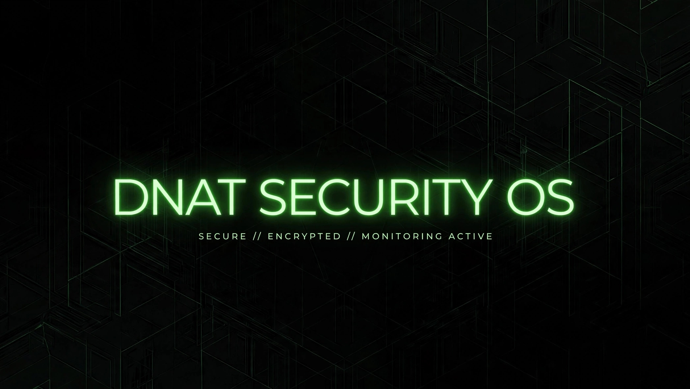

# DNAT SECURITY OS v1.0
### SECURE // ENCRYPTED // MONITORING

> De um wallpaper a uma distro bootável. Buildada do zero no celular.

## O que é?

A DNAT SECURITY OS é uma distribuição Linux Live ARM64 focada em segurança, criada do zero como projeto de estudo e portfólio. Buildada e testada 100% via Termux + Termux:X11.

## Prova de Build

- ISO: DNAT-SECURITY-OS-v1.0-arm64.iso
- Tamanho: 463MB (236832 sectors)
- Filesystem: binary/live/filesystem.squashfs
- Ferramenta: xorriso 1.5.6
- Status: completed successfully

Number of duplicate files removed: 722
Number of inodes: 24924
Number of files: 18681
Number of directories: 2737
Number of symlinks: 3506

## Features v1.0

- Live ISO bootável ARM64
- Base Debian 13 Trixie
- XFCE 4.x totalmente customizado
- Branding DNAT completo
- Build reproducível com live-build

## Download

GitHub não permite arquivos >100MB. ISO mantida como artefato histórico.
Download v1.0 (463MB): Em breve - Drive/MEGA

## Autor

unicrevil / DNAT Security - Caxias do Sul RS, 2026

"Nós não somos os melhores, Mas estamos entre eles." -the best squad
